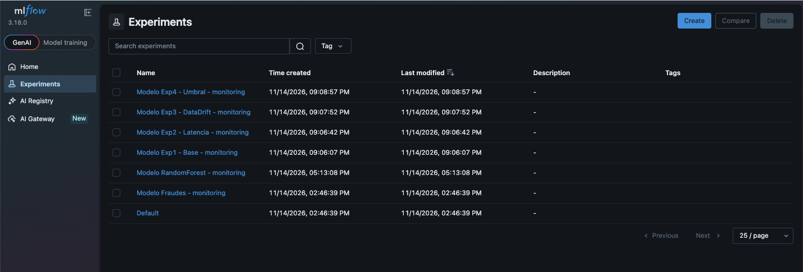
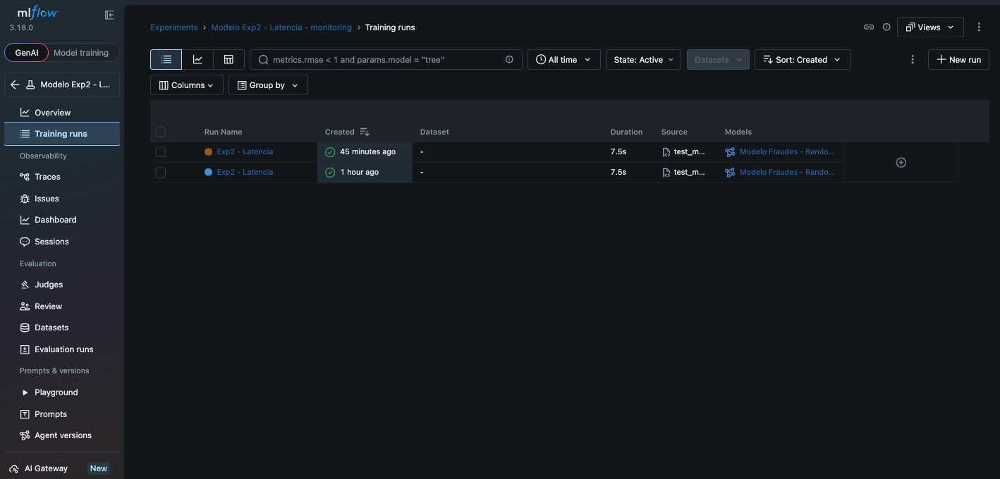

# Actividad 8 - Monitorización, mantenimiento y gobernanza operativa

**Autor:** Miguel Angel García Vidal  
**Modelo:** Random Forest · Fraudes  
**Herramienta:** MLflow 3.18.0

---

## 📋 Descripción

Diseñar e implementar un ecosistema de observabilidad de extremo a extremo para el modelo de detección de fraude de la Fase II, integrando monitoreo técnico, funcional y de negocio mediante MLflow. El alcance incluye la captura y análisis de métricas de rendimiento, calidad predictiva, logs y trazas; la definición de SLIs/SLOs y mecanismos de alertamiento inteligente; la automatización de procedimientos de respuesta a incidentes mediante runbooks operativos, asegurando la confiabilidad, trazabilidad y gobernanza continua del modelo en producción.

---

## 📁 Estructura del Repositorio

```
Actividad-08/
├── Fraudes.py              # Contiene las clases con la lógica para la creación del Modelo de Fraudes, el monitoreo y los Runbooks.
├── monitoring.log          # Log generado al ejecutar test_monitoring.py
├── requirements.txt        # Dependencias
├── test_monitoring.py      # Simulación de monitoreo y generación de incidentes críticos
└── data/
    ├── fraudes.csv         # Dataset para el entrenamiento del modelo.
└── evidencias/
    ├── mlflow_Exp1 - Base.png
    ├── mlflow_Exp2 - Latencia.png
    ├── mlflow_Exp3 - DataDrift.png
    ├── mlflow_Exp4 - Umbral.png
└── results/
    ├── classification_report.json  #Reporte de la clasificación del último entrenamiento del modelo
    ├── confusion_matrix.png        #Matriz de confusiíon del último entrenamiento realizado del modelo
```

---

## ⚙️ Requerimientos e Instalación

```bash
pip install -r requirements.txt
```

| Librería | Versión |
|----------|---------|
| mlflow | 3.18.0 |
| scikit-learn | 1.9.1 |
| numpy | 2.4.6 |
| pandas | 3.1.1 |
| seaborn | 0.13.2 |
| matplotlib | 3.10.9 |

---

## 🚀 Ejecución

### Ejecutar el monitoring mediante la siguiente instrucción:

```bash
python test_monitoring.py
```

Genera 4 Experimentos en MLflow con su run propio cada uno para cada caso: 
- Experimento 1 Base - Modelo entrenado con el DataSet original
- Experimento 2 Latencia Alta - Lanza la evaluación simulando latencias altas. Al ser detectado el error lanza de manera automática el RunBook para simula el crecimiento de la infraestructura para estabilizar la latencia.
- Experimento 3 Data Drift - Modelo degradado; al detectar el error lanza de manera automática el RunBook para ejecutar el entrenamiento con los nuevos datos y evaluar nuevamente para verificar que se ha corregido el error. 
- Experimento 4 Umbral - Modelo original pero con un umbral de 0.50.

### Paso 2 — Ver dashboard MLflow

```bash
mlflow ui
```

Abre `http://localhost:5000` para ver el dashboard con todos los runs, métricas y comparaciones.

---

## 1. Diseño de Monitorización y Observabilidad

### Métricas definidas

| Métrica | Descripción | SLO |
|---------|-------------|-----|
| `Accuracy` | Sensibilidad del modelo | ≥ 0.90 |
| `Precision` | Sensibilidad del modelo | ≥ 0.95 |
| `Recall` | Sensibilidad del modelo | ≥ 0.98 |
| `F1 score` | Sensibilidad del modelo | ≥ 0.95 |
| `latencia_ms` | Tiempo de respuesta por predicción | ≤ 500ms |
| `errors` | Número de SLOs con error | 0 |

### Logs

Se generan dos archivos de log automáticamente:

- **`monitoring.log`** — registra cada run de monitoreo, métricas calculadas y violaciones de SLO detectadas

Formato de log:
```
2026-11-14 16:07:41,578 - MonitorModel - INFO - Monitoring Exp1-Base
2026-11-14 16:33:30,892 - MonitorModel - ERROR - Accuracy 0.8216 debe ser mayor de 0.9
2026-11-14 16:07:42,007 - MonitorModel - WARNING - Simulando degradado del modelo
```

### Trazas en MLflow

Cada run registra automáticamente:
- **Tags:** tipo de incidente, causa, severidad, autor, timestamp, status
- **Parámetros:** configuración del modelo y SLOs
- **Métricas:** todas las métricas del ciclo antes/durante/después
- **Artefactos:** Clasification Report y Confusion Matrix

### Dashboard MLflow — Experimentos Generados



### Run baseline normal


---

## 2. Diseño y Aplicación de Alertas Inteligentes

### SLOs y Error Budgets definidos

```python
self.slo = {
            "latency_max_mx": 500,
            "accuracy_min": 0.90,
            "precision_min": 0.95,
            "recall_min": 0.98,
            "f1_min": 0.95,
            "roc_auc_min": 0.95,
}
```

### Priorización de alertas por severidad

| Severidad | Trigger | Runbook | Tiempo respuesta |
|-----------|---------|---------|-----------------|
| **ALTA** | 'Accuracy' < 0.90 o 'F1' < 0.95 o 'Precision' < 0.95 o 'Recall' < 0.98 o 'Roc_auc' < 0.95: | RUNBOOK-001 Reentrenamiento | 5-10 min |
| **MEDIA** | Latencia > 500ms | RUNBOOK-002 ALTA latencia | 2-5 min |

### Lógica de detección automática

El sistema verifica SLOs después de cada predicción y registra violaciones en MLflow:

```python
 if errors:
                self.logger.error(f"Errors durante el experimento SLO superados: {errors}")
                print("Errors durante el experimento SLO superados:")
                for error in errors:
                    self.logger.error(f"{errors[error]}")
                    print(f"{errors[error]}")
                mlflow.set_tag("status","SLO superado")

                if 'Latencia' in errors:
                    self.runbook_alta_latencia(errors)
                if 'Accuracy' in errors or 'F1' in errors or 'Precision' in errors or 'Recall' in errors or 'Roc_auc' in errors:
                    y_train = self.modelo.y_train
                    self.runbook_reentrena_modelo(X_train, y_train, X_test, y_test, errors)
```

### Ejemplo — DataDrift


El Exp3 `Data Drift` muestra `Precision: 0.9327` por debajo del SLO de 0.95, con `slo_violations 1` y `error_precision_diff: 0.01729`.

---

## 3. Simulación de Incidentes y Runbooks

### Vista general de incidentes simulados



---

### Incidente 1 — Alta Latencia

**Descripción:** Se simula Alta latencia al llamar al modelo, para ello se añade un tiempo de espera de 1.5s

**Impacto detectado:**
- `Latencia: 1850.0569 > SLO 500ms`
- `slo_status: VIOLATION`
- `causa: carga_excesiva`

**Runbook ejecutado:** RUNBOOK-001 Alta latencia

**Resultado:** Latencia recuperada


---

### Incidente 2 — Modelo Degradado

**Descripción:** Se simula una degradación del modelo al multiplicar los datos por un valor de `0.95`

**Impacto detectado:**
- Precision baja de `0.9959` a `0.9327` por debajo del SLO de `0.95`.
- Variación de precisión de `0.01729999`
- `slo_status: VIOLATION`

**Runbook ejecutado:** RUNBOOK-002 REENTRENA

**Resultado:** Modelo reentrenado con los nuevos datos, recuperando los SLOs:
`{'Latency': 328.5151, 'Accuracy': 0.9991, 'Precision': 0.9959, 'Recall': 1.0, 'F1_score': 0.9979, 'Roc_auc': 1.0}`


---

## 4. Documentación de Respuesta Automatizada

### Catálogo de Runbooks
#### RUNBOOK-001 — Escalamiento del servicio
```
Trigger:    Latencia > 500ms
Severidad:  MEDIA
Tiempo:     2-5 minutos

Pasos:
1. Detectar Latencia
2. Identificar causa
3. Escalar Infraestructura
4. Verificar recuperación de SLOs latencia
5. Registrar evento
```

#### RUNBOOK-002 — Reentrenamiento del modelo
```
Trigger:    'Accuracy' < 0.90 o 'F1' < 0.95 o 'Precision' < 0.95 o 'Recall' < 0.98 o 'Roc_auc' < 0.95: 
Severidad:  ALTA
Tiempo:     5-10 minutos

Pasos:
1. Detectar violación de SLO
2. Descargar dataset actualizado
3. Reentrenar modelo con parámetros optimizados
4. Evaluar el nuevo modelo cumple SLOs
5. Reemplazar modelo en producción
6. Registrar evento en log de incidentes
```
#### Estrategia de detección de Data Drift

El sistema detecta data drift monitoreando la degradación de métricas:

| Indicador | Condición de alerta |
|-----------|---------------------|
| Caída de Accuracy | Por debajo de SLO 0.90|
| Caída de recall | Por debajo de SLO 0.80 |
|Caida de F1 | Por debajo de SLO 0.95|
|Caida de Precision| Por debajo de SLO 0.95|
|Caida de Recall| Por debajo de SLO 0.98|
|Caida de Roc_Auc| Por debajo de SLO 0.95| 

Cuando se detecta drift, se activa automáticamente RUNBOOK-002 para reentrenar el modelo con datos actualizados.

### Flujo completo de respuesta automatizada

```
Predicción en producción
        ↓
Cálculo de métricas
        ↓
Verificación de SLOs
        ↓
¿Violación detectada?
    ├── NO → Log "OK" en MLflow → Continuar
    └── SÍ → Clasificar severidad
                ├── ALTA    → RUNBOOK-002 Reentrenamiento
                └── MEDIA   → RUNBOOK-001 Alta Latencia
                        ↓
                Verificar recuperación
                        ↓
                Registrar resolución en MLflow
```

---

## 📊 Comparación de Experimentos

| Run | Precision |  Latencia | SLO Status |Precision Post Corrección|Latencia Post Corrección|
|-----|--------|---------------|------------|-----|-----|
| Exp1 - Base  | 0.9959 | 333.709ms | ⚠️ Especificidad |N/A|N/A|
| Exp2 - Latencia | 0.9959 | 1850.0569ms | ✅ Resuelto |N/A|357ms|
| Exp3 - DataDrift |  0.9327 | 339.3238 | ✅ Resuelto |0.9959|N/A|
| Exp4 - Umbral | 0.9991|323.096|⚠️ Especificidad|N/A|N/A|


---

## 📝 Conclusiones

La estrategia de operación propuesta integra mecanismos de observabilidad, monitoreo y respuesta automatizada que fortalecen la confiabilidad del sistema de inteligencia artificial en producción. En primer lugar, el uso de MLflow facilita el seguimiento continuo de indicadores de desempeño y el cumplimiento de los SLOs definidos, permitiendo la detección temprana de degradaciones operativas. En segundo lugar, el monitoreo del data drift resulta fundamental en contextos de riesgos financieros, donde cambios en la distribución de los datos pueden reducir la capacidad predictiva del modelo y aumentar la probabilidad de omitir eventos fraudulentos. Finalmente, la incorporación de runbooks automatizados mejora la capacidad de respuesta ante incidentes, reduciendo significativamente los tiempos de recuperación y garantizando mayores niveles de disponibilidad, continuidad y calidad del servicio.

---
