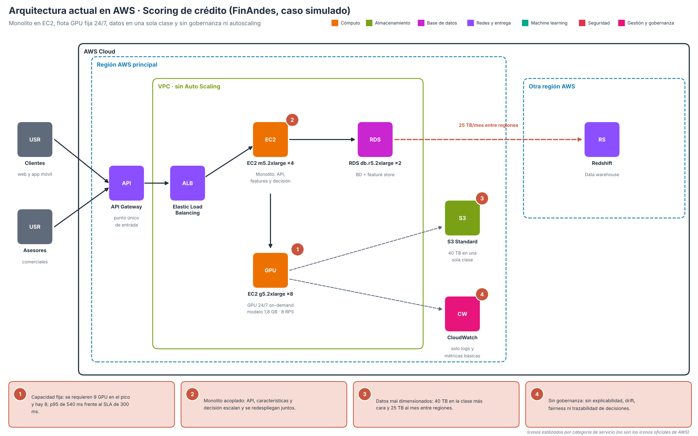
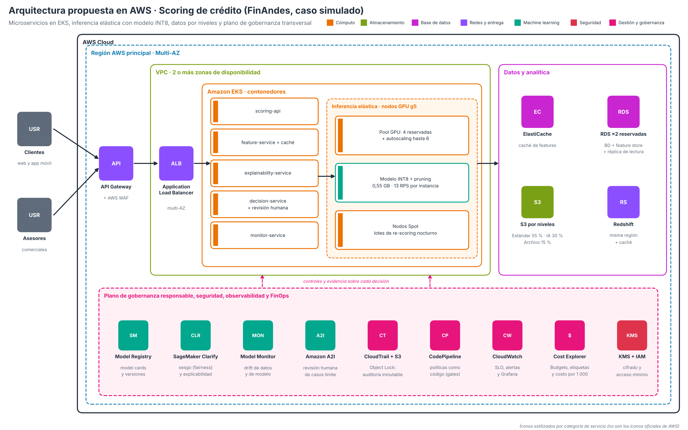

# Actividad 9 - Escalar soluciones de inteligencia artificial y aplicar principios de gobernanza y ética.
**Autor:** Miguel Angel García Vidal

---
## 📋 Descripción

La institución financiera FinAndes(simulada), automatizó la aprobación de créditos con un modelo de inteligencia artificial desplegado en la nube. El sistema redujo los tiempos de respuesta, pero en producción mostró tres problemas encadenados: una arquitectura monolítica y sobredimensionada que no resiste los picos de demanda y es costosa en los valles, un modelo sin controles de equidad que rechaza de forma desproporcionada a ciertos grupos, y una gobernanza insuficiente para demostrar el cumplimiento ante una auditoría externa.

El [reporte técnico](Reporte_técnico.docx) analiza la arquitectura actual y propone un rediseño en dos frentes que se refuerzan entre sí. 
1.	Técnico y financiero: escalabilidad horizontal con autoscaling, right-sizing, cuantización y pruning del modelo, microservicios, almacenamiento por niveles y prácticas FinOps. 
2.	Gobernanza responsable: una auditoría ética, técnica y legal, una mitigación de sesgos y un plan de escalamiento con compuertas verificables.

Para la generación del reporte técnico nos apoyamos del [Anexo técnico](Anexo_Tecnico.xlsx), el cual cuenta con Tablas comparativas de costos; Métricas de desempeño (latencia, throughput y uso de recursos) y evaluación de fairness y sesgos.

Finalmente de manera gráfica se cuenta con el [Diagrama de Arquitectura](Diagrama_Arquitectura.pptx) en donde se tiene la representación del sistema actual vs el sistema propuesto.  

## 📁 Estructura del Repositorio
```
Actividad-09/
├── Reporte_técnico.docx            
├── Anexo_Tecnico.xlsx              
├── Diagrama_Arquitectura.pptx      
├── Arquitectura_AWS_Actual.png     # Imagen generada con IA de la arquitectura actual de acuerdo a lo descrito en el reporte técnico.
├── Arquitectura_AWS_Propuesta.png  # Imagen generada con IA de la arquitectura propuesta de acuerdo a lo descrito en el reporte técnico.
```
---
## Arquitectura actual


## Arquitectura propuesta
